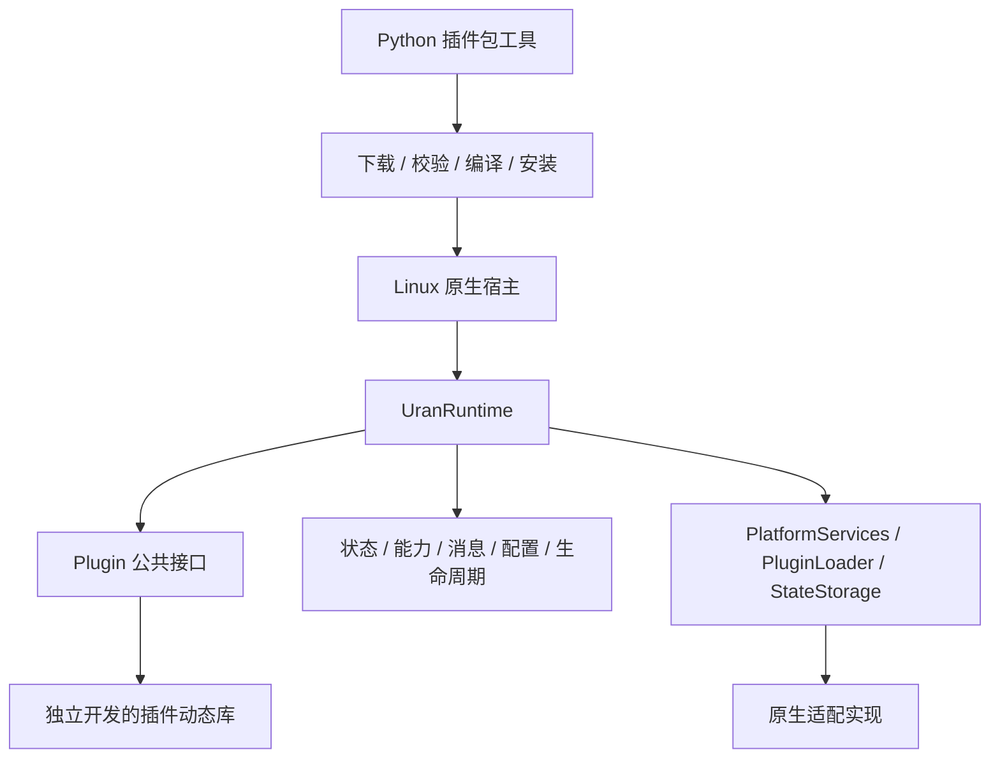

# URAN Framework 2

`uran_framework` 是独立的 C++17 框架，配套 Python 插件包工具。核心通过接口接入平台服务、动态加载器与状态存储。默认装配为空，可以不安装 ROS、不接入设备或云平台直接运行。ROS 2 已迁入独立的 `uran_ros2_adapter` 仓库，通过安装后的框架 SDK 构建。

当前提供插件生命周期和多实例装配、设备/组件身份、能力发现、通用消息路由、多协议选择、状态管理和持久化、运行时管理，以及插件包下载、源码编译、安装与应用。仓库中的回环协议和 `example.echo` 仅验证框架机制，没有接入运控、图传、导航、按键映射、任务规划、模型或 Agent 业务。



## 构建与测试

Linux 原生版本需要 C++17 编译器、CMake（建议 3.20+）、yaml-cpp、nlohmann_json 3.10+。测试额外需要 GoogleTest 和 Python 3.9+；插件包工具只使用 Python 标准库。Ubuntu 可安装 `build-essential cmake libyaml-cpp-dev nlohmann-json3-dev libgtest-dev python3`。未找到 nlohmann_json 时，默认下载固定版本并校验 SHA-256；离线构建请预装依赖并设 `-DURAN_FETCH_DEPENDENCIES=OFF`。

在本目录执行：

```bash
bash scripts/build.sh
bash scripts/test.sh
```

脚本使用普通 CMake 构建并安装至 `install/`，不自动安装系统依赖。可通过 `URAN_BUILD_DIR`、`URAN_INSTALL_PREFIX`、`URAN_BUILD_JOBS` 覆盖目录与并发数，也可直接调用：

```bash
cmake -S . -B build -DCMAKE_BUILD_TYPE=RelWithDebInfo \
  -DCMAKE_INSTALL_PREFIX="$PWD/install"
cmake --build build --parallel 2
cmake --install build
ctest --test-dir build --output-on-failure
```

仅构建可复用核心和通用示例，不构建 Linux 原生适配器：

```bash
cmake -S . -B build-core -DURAN_BUILD_NATIVE=OFF
cmake --build build-core --parallel 2
ctest --test-dir build-core --output-on-failure
```

交付 SDK 时可设 `-DBUILD_TESTING=OFF`，不再要求 GoogleTest/Python 测试环境。原生宿主及包工具当前面向 Linux；其他操作系统需要提供相应平台适配器。

## 运行空框架

```bash
./install/bin/uran_runtime --config config/runtime.yaml \
  --state-file /tmp/uran-state.json --control-socket /tmp/uran.sock
```

在另一终端管理：

```bash
python3 scripts/uran_plugin.py request --socket /tmp/uran.sock '{"op":"status"}'
python3 scripts/uran_plugin.py request --socket /tmp/uran.sock '{"op":"snapshot"}'
python3 scripts/uran_plugin.py request --socket /tmp/uran.sock '{"op":"shutdown"}'
```

不传 `--control-socket` 时，宿主从标准输入逐行读取 JSON 命令，输入结束后退出。Socket 模式保持运行，可通过管理命令或 SIGINT/SIGTERM 停止。

运行主备回环协议验证链路：

```bash
./install/bin/uran_runtime --config config/loopback.yaml \
  --manifest install/share/uran_framework/plugins/loopback/plugin.json \
  --control-socket /tmp/uran.sock
```

```bash
python3 scripts/uran_plugin.py request --socket /tmp/uran.sock \
  '{"op":"publish","message_type":"framework.echo","payload":{"value":1},"correlation_id":"demo"}'
python3 scripts/uran_plugin.py request --socket /tmp/uran.sock \
  '{"op":"deactivate","instance_id":"protocol_primary"}'
```

回环下行事件输出到宿主标准输出，带协议实例来源。停用主实例后会选择可用的备用协议。

## 下载、编译并应用扩展

先运行上面的空框架，然后：

```bash
python3 scripts/uran_plugin.py pack examples/extension --output /tmp/extension.tar.gz
python3 scripts/uran_plugin.py install /tmp/extension.tar.gz \
  --store /tmp/uran-plugins --sdk-prefix "$PWD/install" \
  --runtime-socket /tmp/uran.sock --instance-id echo_extension
python3 scripts/uran_plugin.py request --socket /tmp/uran.sock \
  '{"op":"dispatch","message_type":"example.echo","payload":{"value":42},"target":{"instance_id":"echo_extension"}}'
python3 scripts/uran_plugin.py request --socket /tmp/uran.sock '{"op":"snapshot"}'
```

快照中会出现 `plugin.echo_extension.last_message`。将安装命令中的本地路径换为 HTTPS URL 并提供 `--sha256`，即可走下载、验证、构建与应用流程。安装目录中的同一包版本不可覆盖；重复试验应使用新 store 或新版本。详细格式和升级语义见[插件包与二次开发](docs/插件包与二次开发.md)。

## ROS 2 适配

ROS 2 宿主、pluginlib Loader、launch 和 ROS 冒烟测试由独立的 `uran_ros2_adapter` 仓库交付。该仓库只通过安装后的 `uran_plugin_api`、`uran_core_framework` 和 `uran_platform_native` CMake 包消费本仓库 SDK；本仓库不查找 ROS，也不包含 ROS package。

## 文档与迁移

- [多仓库拆分与完整迁移方案](docs/多仓库拆分与完整迁移方案.md)：六个独立仓库、第三方依赖归属、旧分支迁移、部署与验收；包含后续仓库的本地落位约定。
- [目前框架说明](docs/目前框架说明.md)：现有功能、管理接口、验证范围及研发计划对应关系。
- [插件化架构说明](docs/插件化架构说明.md)：分层、生命周期、线程、状态与消息契约。
- [插件包与二次开发](docs/插件包与二次开发.md)：外部 SDK、包格式、下载应用及平台扩展。

这是 API 2.0 / 原生 ABI 2 的不兼容升级。旧插件需要移除 `PluginContext` 中的 ROS Node 访问，改用公共服务接口，更新版本并重新编译；原 ROS 插件 XML 导出移至适配包。`ros_namespace` 改为不带平台含义的 `route_scope`，ROS Topic 路径只由 ROS 适配层配置。
