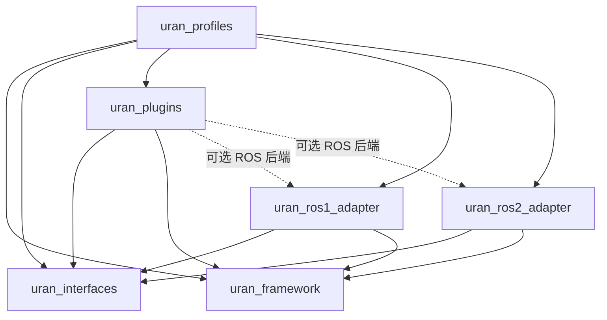

# URAN 多仓库拆分与完整迁移方案

文档日期：2026-09-16。状态：目标架构和分阶段实施方案；framework、interfaces、plugins、ROS1/ROS2 adapter 已建立独立仓库，ROS1/PX4 软件迁移已通过 Noetic 验证，`uran_profiles` 暂缓。

本方案承接 `uran_rebuild` 的独立框架改造，将后续研发组织为六个独立 Git 仓库。已完成仓库边界、契约和 ROS1/PX4 软件基础迁移；机器人 Profile、真实厂商消息和硬件验收仍按后续阶段推进。

**本地落位约定：后续创建或克隆的新仓库，统一放在 `/home/feiyu/URAN/workspace` 内。该目录只是本机的存放位置，不是仓库、产品模块或构建依赖，以下目录架构不包含它。** 当前 `uran_ws`、`uran_rebuild` 作为迁移源保留；本文件记录方案，不表示已移动、删除或归档旧仓库。

## 1. 迁移依据与完成边界

本次依据本地已有 Git 引用，不代表远端此后没有更新：

| 迁移源 | 基线 | 可复用内容 | 主要限制 |
| --- | --- | --- | --- |
| `uran_rebuild/main` | `2cd172e` | C++ API 2.0、Runtime、原生宿主、可选 ROS2 宿主、状态持久化、插件包工具、SDK 与测试 | 该基线尚无机器人业务、ROS1 适配、Profile 部署器及完整依赖解析 |
| `uran_ws/origin/ROS1` | `90c227a` | MQTT/状态逻辑、PX4 运控、DLIO、规划器、启动顺序与无人机部署经验 | rospy/厂商接口与业务耦合，大量第三方源码混入同一工作空间 |
| `uran_ws/origin/ROS2-refactored` | `92dab37` | uran_base 的模块拆分、协议工厂、状态/路由/注册、CyberDog2 和媒体/任务实现 | uran_base 仍依赖 rclpy；运动入口仍以单插件模型为主 |
| `uran_ws/main` | `300d703` | ROS2 业务的后续修复、运动保护、定位/避障和设备启动调整 | 与 ROS2-refactored 已存在差异，不能用任一分支全量覆盖另一分支 |

实际迁移启动前记录新的源 commit；比较三个旧业务分支的差异，保留修复和测试的来源。源文件映射、对应 commit、取舍原因写入迁移台账。

| 要解决的问题 | 已有基础 | 本方案补齐内容 |
| --- | --- | --- |
| URAN 与机器人耦合 | 通用核心已经独立 | 将机器人/厂商逻辑迁入独立发布的插件，制定公共业务契约 |
| 一台设备有多个运动部件 | 实例/设备/组件身份及目标路由 | 部件模型、控制权仲裁、异步操作、部件级状态与协同规则 |
| 部署和装载适配包困难 | 原生插件下载、校验、构建、安装、应用 | Profile、版本锁定、依赖预检、服务编排、整套发布与回滚 |
| ROS1/ROS2 双分支维护 | 核心不依赖 ROS，已有 ROS2 宿主 | 两个薄适配仓库，共用契约和业务实现，逐步退出旧业务分支 |
| 第三方仓库混乱 | SDK、manifest、版本目录及摘要校验 | 明确依赖归属、锁定来源、保留补丁、隔离构建和发布制品 |

现有 `uran_plugin.py` 只支持 schema 1 下的 `cmake`/`prebuilt` 插件包，环境要求只检查 OS、架构和命令。本文的 Profile、依赖 lock、进程插件、操作取消等设计均为待实现能力，不能直接交给现有解析器使用。

## 2. 六个独立仓库及职责

| 仓库 | 职责 | 主要交付物 | 不承载的内容 |
| --- | --- | --- | --- |
| `uran_framework` | 接续 uran_rebuild；公共插件 API、Runtime、原生平台、通用包/部署工具 | SDK、运行时、命令行工具、部署描述 schema | 厂商控制逻辑、ROS 消息、机器人型号配置 |
| `uran_interfaces` | 与传输平台无关的业务契约 | 消息/状态/能力 schema、C++/Python 数据绑定、契约测试 | 硬件调用、控制算法、ROS executor、运行时管理器 |
| `uran_plugins` | 官方协议、运动、媒体、传感器和任务扩展 | 每个插件的独立安装包及可选工作进程 | 框架副本、通用 ROS 宿主、整机现场配置 |
| `uran_ros1_adapter` | ROS1 宿主/桥接及契约与 ROS1 的转换 | ROS1 消息包、桥接程序、可选宿主、适配 SDK | MQTT/任务规则的另一份实现、PX4 专用业务 |
| `uran_ros2_adapter` | 接续当前 ROS2 适配代码，提供 ROS2 宿主/桥接 | ROS2 消息包、pluginlib 后端、宿主、适配 SDK | CyberDog 专用控制、整机私有配置 |
| `uran_profiles` | 定义机器人产品装配和可复现部署版本 | Profile、运行时装配、发布锁、服务/设备规则、验收场景 | 插件源码、厂商 SDK、第三方源码、大型模型 |

独立仓库指独立 `.git`、版本、CI、发布流程。一个仓库可以发布多个包：例如 `uran_plugins` 是一个仓库，MQTT 和机械臂插件各自发布版本。无需为每个插件立即建立新仓库；只有团队权限、许可证或发布周期确实独立时再拆。

API/ABI 与业务契约分开：`uran_plugin_api` 仍属于框架，规定插件如何被加载和调用；`uran_interfaces` 规定运动、媒体、任务消息意味着什么。后者单独成库，避免 ROS1、ROS2 和各机器人插件各自维护不同定义。

### 2.1 uran_framework

```text
uran_framework/
├── CMakeLists.txt
├── src/
│   ├── uran_plugin_api/
│   ├── uran_core_framework/
│   ├── uran_platform_native/
│   └── uran_core_example_plugins/   # 中立回环示例
├── cmake/
├── config/                         # 空装配和中立回环装配
├── examples/extension/             # 仅依赖安装 SDK 的示例
├── scripts/                        # 保留 build.sh、test.sh、uran_plugin.py
├── schemas/deployment/             # 待实现：包、Profile、锁文件 schema
├── tests/
├── packaging/                      # 框架自身的系统包/制品定义
└── docs/
```

先保留现有 CMake package 名、include 路径、target 名及 API 2.0，避免仓库重命名同时造成 SDK 破坏性升级。`uran_framework` 无条件不查找 ROS；拆分后删除根构建中的 `URAN_BUILD_ROS2` 分支，ROS 构建入口转至相应仓库。保留 `URAN_BUILD_NATIVE` 和核心独立构建方式。

### 2.2 uran_interfaces

```text
uran_interfaces/
├── schemas/
│   ├── components/
│   ├── motion/
│   ├── media/
│   ├── sensors/
│   ├── tasks/
│   └── operations/                 # 请求、接受、进度、完成、取消等语义
├── bindings/
│   ├── cpp/
│   └── python/
├── generators/
├── fixtures/                       # 合法/非法消息及跨语言期望结果
├── tests/
├── CMakeLists.txt
├── pyproject.toml
└── docs/
```

schema 是唯一权威定义，生成器版本参与锁定；生成文件进入构建目录和发布包，不手工维护两份。C++ 包及 Python wheel 可以独立使用，不要求安装 ROS 或 Runtime。ROS `.msg/.srv/.action` 及转换实现留在适配仓库，并通过公共 fixtures 验证含义一致；不是所有公共契约都要一对一生成 ROS 类型。

### 2.3 uran_plugins

```text
uran_plugins/
├── protocols/
│   ├── mqtt/
│   └── websocket/
├── motion/
│   ├── control_arbiter/
│   ├── cyberdog2/
│   ├── px4/
│   └── arm_vendor_a/               # 规划名称，实际厂商确定后替换
├── media/
├── sensors/
├── tasks/
├── simulation/                    # 验证用虚拟底盘/机械臂等
├── common/                        # 已有多个消费者的可复用业务实现
├── packaging/                     # 各插件的构建、发布矩阵
└── docs/
```

上述业务目录按阶段逐项建立，不因存在目录名就宣称已接入设备。`motion` 是源码分类，不是一个只能选择一个实现的全局运行实例。

一个插件的标准结构：

```text
cyberdog2/
├── CMakeLists.txt                  # 可从该插件根目录独立构建
├── uran-package.json
├── plugin.json.in
├── include/
├── src/                           # 共用的指令映射、状态和业务规则
├── backends/                      # 厂商 SDK 或 ROS 专用薄后端
├── workers/                       # 如需：Python/厂商环境工作进程
├── config/defaults.yaml           # 通用默认值，不含现场连接凭据
├── schemas/config.schema.json
├── third_party/                   # 仅该插件拥有的依赖描述/补丁
├── tests/
└── README.md
```

通用算法和业务规则不得 import rospy/rclpy。确实使用 ROS 厂商驱动的后端可依赖相应 ROS SDK，但只在自己的独立构建目标中链接，不将该依赖传播到框架或不使用它的插件。

### 2.4 uran_ros1_adapter 与 uran_ros2_adapter

```text
uran_ros1_adapter/
├── src/
│   ├── uran_ros1_msgs/
│   └── uran_ros1_adapter/          # 桥接、可选宿主、通用转换
├── launch/                        # 平台通用启动模板
├── config/
├── tests/
├── packaging/
└── docs/
```

```text
uran_ros2_adapter/
├── src/
│   ├── uran_ros2_msgs/
│   └── uran_ros2_adapter/          # 保留当前 ROS package 名
├── examples/                      # 中立插件的 ROS 导出/启动示例
├── launch/
├── config/
├── tests/
├── packaging/
└── docs/
```

适配仓库只理解 URAN 公共契约和 ROS 概念；CyberDog 的 motion_id、PX4 的 OFFBOARD 保活、相机厂商服务等映射仍由插件后端负责。第三方 ROS 包保留其原有名称与构建方式，不因迁入而伪装成 URAN 自有代码。

### 2.5 uran_profiles

```text
uran_profiles/
├── profiles/
│   ├── cyberdog2/
│   ├── px4_drone/
│   └── cyberdog2_with_arm/
├── releases/                      # 整机发布记录及完整锁文件
├── environments/                  # 工具链/系统镜像和开发依赖锁
├── templates/                     # 可复用部署模板
├── tests/                         # 装配、迁移和整机验收场景
└── docs/
```

一个 Profile：

```text
cyberdog2_with_arm/
├── profile.yaml                   # 产品组成及所选宿主
├── runtime.yaml                   # 插件运行实例装配
├── deployment.lock.json           # 框架、契约、适配器、插件、依赖的精确版本
├── config/                        # 该产品的参数覆盖
├── services/                      # systemd/进程启动描述
├── udev/                          # 必要设备规则
├── calibration/                   # 标定模板，现场值另行管理
├── checks/                        # 安装及启动健康检查
└── README.md
```

`uran_plugins/motion/arm_vendor_a` 决定如何控制机械臂；`uran_profiles/profiles/cyberdog2_with_arm` 决定是否装配该机械臂、创建哪些实例及使用哪一版插件。Profile 可以携带部署脚本和检查，但不能把运动算法、任务状态机藏进脚本。机器人凭据和逐台标定值放在部署端受控配置中，仓库只保存模板与引用。

## 3. 依赖方向与进程部署

### 3.1 编译与发布依赖

图中箭头表示“使用已发布的包或制品”，不表示读取兄弟仓库源码：



约束如下：

1. 框架不依赖业务契约、机器人插件、Profile 或 ROS；契约仓库不依赖框架运行时。
2. 通用插件仅依赖公共 API、契约及自己的第三方库。插件不直接链接 `uran_core_framework` 的内部管理器。
3. ROS 适配仓库不依赖官方机器人插件；集成验证时可下载插件制品，不能反向形成生产构建依赖。
4. Profile 引用发布制品，不成为任何代码包的编译依赖。
5. 跨仓库通过 `find_package`、Python 包、制品版本或显式 SDK 前缀连接；禁止 `add_subdirectory(../uran_framework)`、相对路径 include、全局 PYTHONPATH 和依赖某人本地目录。
6. 修改 SDK 后先安装到隔离前缀再构建消费者。每个仓库都必须在只有依赖制品、没有其他源码 checkout 的环境中通过构建。

### 3.2 宿主选择与旧 Python 业务迁移

一个设备的同一组插件和状态，只有一个权威 Runtime。Profile 明确选择 `native`、`ros2`，或后续实现的 `ros1` 宿主；不能同时启动三个独立 Runtime 再假设它们共享状态。

单 ROS2 设备初期复用当前 ROS2 宿主。混合 ROS1/ROS2 或旧厂商系统，目标采用“原生 Runtime + 独立 ROS 桥接/工作进程”：ROS 环境和厂商 SDK 保留在各自进程中，经版本化 IPC 传递通用命令与反馈。该桥接尚未实现，不能将当前管理 Socket 当作实时运动或图传通道。

原有业务大量使用 Python，API 2.0 不能直接加载 Python 插件。迁移顺序为：

- 先提取可独立测试的纯 Python 业务模块，用独立 worker 保留逻辑，通过框架的进程适配插件管理生命周期。
- 在 worker/IPC 支持完成前，只能将旧节点作为过渡外部服务运行；它尚未拥有完整 URAN 插件生命周期，文档和状态需要明确标注。
- 为关键运行路径按收益逐步提供 C++ 实现，不要求为仓库拆分一次性重写全部 Python。

框架提供通用进程托管/IPC 机制，ROS 适配仓库提供 ROS 通信转换，机器人插件拥有实际业务和厂商接口调用。进程协议需定义握手、版本、身份、断线、背压、超时、重连及反馈；高带宽媒体走专门数据通道。`ros1_bridge` 可辅助旧节点过渡，但不能代替 URAN 操作状态、控制权和依赖版本管理。

## 4. 多运动部件与业务契约

### 4.1 身份模型

沿用现有 `device_id`、`component_id`、`instance_id`。在契约层定义 `MotionPart`，以 `(device_id, component_id)` 作为部件的稳定标识，实例只是当前实现提供者。暂不新增与 component_id 重复且可能不一致的 `move_part_id`；如未来需要多个命名系统，应给出显式映射与迁移规则。

例如同一台机器：

| 设备 | 部件 component_id | 插件实例 | 能力示例，待契约确定 |
| --- | --- | --- | --- |
| robot_001 | base | base_motion | motion.base.velocity、motion.base.posture |
| robot_001 | arm_left | arm_left_motion | motion.arm.pose |
| robot_001 | gripper | gripper_motion | motion.gripper.action |

MotionPart 描述父部件、部件类型、坐标系、资源组和可用能力。底盘速度、机械臂关节、末端位姿使用不同的类型化载荷，不继续将所有操作塞入一个 action 字符串和 extra_json。

### 4.2 装配样例及当前限制

下面只使用当前 Runtime 已支持的 YAML 装配字段；类名和配置是未来业务插件的示意，当前没有这些实现：

```yaml
default_device_id: robot_001
plugins:
  - instance_id: base_motion
    component_id: base
    class_type: cyberdog2/MotionPlugin
    api_version: "2.0"
    config:
      backend: ros2
  - instance_id: arm_left_motion
    component_id: arm_left
    class_type: vendor_a/ArmPlugin
    api_version: "2.0"
    config:
      endpoint: tcp://192.168.1.20:9000
```

部件之间通过显式 target 区分；只给相同 capability 时，当前路由会选择一个优先提供者，不会广播给所有运动部件。业务接入口必须对缺失或歧义目标返回明确错误，不能将未处理回调的“已转交”解释成实际执行成功。

### 4.3 需要实现的公共能力

| 内容 | 契约与实现归属 | 验收要点 |
| --- | --- | --- |
| 运动命令、状态、能力 | interfaces 定义，motion 插件实现 | 单位、坐标系、时间、有效期、序列号、目标部件一致 |
| 长任务操作 | interfaces 定义操作状态；框架补充中立调用机制 | 区分 accepted/running/succeeded/failed/cancelled，支持超时与取消 |
| 控制权仲裁 | interfaces 定义租约/资源；control_arbiter 插件执行 | 云端、现场、任务按资源申请控制权，部件互不误锁 |
| 多部件协同 | tasks/协调插件；Profile 声明装配与策略参数 | 底盘与机械臂的协同顺序、失败停止和恢复可测试 |
| 急停和失联 | 公共状态契约；设备插件实现设备特定动作 | PX4 降落、底盘停止、机械臂停机不能共用错误动作映射 |
| 设备状态 | instances 写自有字段，公共契约规定字段含义 | 禁止所有部件共写无作用域的 control_mode/failsafe_active |

当前 `MessageAccess` 只有经协议网关上行的 publish，没有插件间本地调用、请求结果关联或公共状态订阅。后续为任务/协调插件增加受控的本地调用接口和必要的订阅机制，或明确使用独立协调服务；不能直接访问 Manager，也不能假设“查到能力”就能调用能力。公共虚接口发生变化时，按第 7 节处理 API/ABI 升级。

## 5. 第三方库、ROS 包和厂商 SDK 放在哪里

### 5.1 归属规则

**依赖归使用它的模块所有。六个仓库之外不建立一个收纳所有依赖源码的公共 third_party 仓库。** 未修改的依赖优先来自包管理器或固定摘要的制品；需要源码补丁时，在所属仓库保存来源记录和补丁。

| 第三方内容 | 所有者和目录 | 源码/二进制实际存放 | 引入方式 |
| --- | --- | --- | --- |
| yaml-cpp、nlohmann_json | framework 的 cmake/依赖清单 | 系统前缀、构建缓存或受控制品 | find_package；下载回退锁定版本和摘要 |
| MQTT 库 | plugins/protocols/mqtt/third_party | 系统前缀或该插件构建缓存 | 依赖清单与 target_link_libraries |
| CyberDog 厂商 SDK/接口包 | plugins/motion/cyberdog2/third_party | SDK 安装前缀或受控 ROS 构建环境 | 明确的 SDK 版本、ROS 版本及构建参数 |
| PX4/px4ctrl、MAVROS | plugins/motion/px4/third_party | 独立 vendor 构建环境或发布制品 | 锁定源码/系统包；URAN 控制封装留在 src/backends |
| DLIO | 使用它的定位插件，如 plugins/sensors/dlio/third_party | 插件构建缓存或独立 ROS 进程 | 保留上游命名和许可证，通过定位契约输出状态 |
| EGO/其他规划器 | 对应 tasks/navigation 插件的 third_party | 插件构建缓存或独立算法进程 | 插件声明能力，Profile 选择具体实现 |
| ROS 中间件通用桥接库 | 对应 ROS 适配仓库的 third_party/依赖清单 | 对应 ROS 系统前缀/构建缓存 | rosdep/系统包或固定源码 |
| 大型视觉模型/权重 | 对应算法插件的模型清单 | 模型制品库和设备模型缓存 | 模型 ID、格式、版本、摘要、运行后端 |
| 产品专用部署工具 | profiles 的 services/checks | Profile 发行包 | 只做部署及诊断，不调用隐藏运动算法 |

CyberDog/PX4 的 **URAN 封装代码是插件**；CyberDog SDK、PX4/px4ctrl、MAVROS 的 **上游实现是第三方依赖**。二者需要分别管理，不能因名称相同就把上游代码改成 URAN 自有插件代码。

### 5.2 源码型依赖布局

```text
third_party/
└── vendor_library/
    ├── dependency.yaml            # URL、精确 commit/发布版本、摘要、许可证
    ├── patches/                   # 与上游基线对应的补丁序列
    ├── CMakeLists.txt             # 必要时提供构建包装 target
    ├── LICENSES/
    └── README.md                  # 为什么引入、谁维护、如何升级
```

默认不把下载源码提交 Git。源码下载到 `build/_deps/`，也可以由显式配置的共享缓存复用；缓存不是依赖版本的权威来源。离线构建使用已校验的源码/二进制镜像。

若确需将源码随仓库交付，可添加 `upstream/`，保留上游文件和版权信息，并用快照或固定 commit 的 submodule 管理。submodule 只用于经过选择的源码依赖，不把六个主仓库再嵌套成超级仓库。私有 fork 保留上游关联、补丁来源和归并记录，避免无出处地复制目录。

第三方 ROS 多仓库集合可以用 `.repos` 声明下载，lock 必须固定 commit；`.repos` 不负责 apt/pip 依赖、补丁和整机部署，仍要纳入部署锁。不得依赖 branch/latest 的浮动内容完成正式发布。

### 5.3 构建隔离与环境规则

- C++ 通过导出的 CMake target 使用库，不把兄弟仓库或第三方绝对路径写进公共头文件；依赖仅供实现使用时标为 PRIVATE。
- Python 在独立 venv/worker 中安装锁定 wheel 和依赖；只有测试通过的公共逻辑共用一份源码。ROS 系统 Python 与插件 Python 版本分别记录。
- ROS 进程可以 source 指定发行版及锁定的安装 overlay；禁止依赖“某开发者之前碰巧 source 过的另一个工作空间”。overlay 顺序由环境清单生成并验证。
- 厂商 SDK、模型权重、大型二进制进入制品库，不进入普通 Git；许可证禁止分发时，部署器检查用户已安装的路径并验证版本。
- 框架 C++ ABI 不保证任意工具链互通。不同 ROS 系统的编译器/标准库冲突时优先进程隔离，不把不同 ABI 的 SDK 强行加载进一个宿主。
- 包构建脚本只能获取锁文件声明的来源；CI 发布构建在依赖准备后关闭非声明下载。不得在运行时执行任意 git pull 自动升级。

## 6. 包、Profile 与部署锁

### 6.1 四种不同的描述对象

| 文件 | 归属 | 作用 | 当前支持情况 |
| --- | --- | --- | --- |
| `plugin.json` | 插件发行包 | 实现类到动态库的映射 | 原生 Loader 已支持 schema 1 |
| `uran-package.json` | 插件源码/二进制包 | 包身份、API、环境检查、构建方式 | 工具已支持 schema 1 的有限字段 |
| `profile.yaml` + `runtime.yaml` | Profile | 选哪种宿主、装配哪些部件/实例、使用何种参数 | runtime.yaml 已支持；Profile 编排待实现 |
| `deployment.lock.json` | 整机发布版本 | 固定全部制品、依赖、平台和参数摘要 | 待实现，不能等同当前 store/index.json |

当前 `index.json` 仅记录每个已安装插件包的选中版本、manifest 路径和下载摘要，不是完整依赖锁，也不自动恢复上次进程中动态创建的实例。重启装配需要保存并验证 runtime.yaml。

新工具先保留现有 schema 1 的可执行功能。Profile、dependencies、worker 等扩展先定义新 schema 并实现解析/验证；含必需新语义的包必须让旧工具明确拒绝，不能静默忽略字段后继续安装。

### 6.2 拟定 Profile 字段

下例是新 Profile 格式的设计示例，尚不能被现有工具执行；所引用类、版本和硬件只是占位设计：

```yaml
schema_version: 1
profile_id: cyberdog2_with_arm
runtime:
  host: native
  assembly: runtime.yaml
release_lock: deployment.lock.json
components:
  - component_id: base
    kind: locomotion
    instance_id: base_motion
  - component_id: arm_left
    kind: manipulator
    parent_component_id: base
    instance_id: arm_left_motion
services:
  - ros2_bridge
  - vendor_arm_worker
config:
  defaults: config/defaults.yaml
  site_overlay_required: true
checks:
  preflight: checks/preflight.yaml
  startup: checks/startup.yaml
```

部署器校验 component 与插件实例引用一致、父部件无环、所需能力存在、服务依赖无环、配置满足插件 schema、设备绑定没有重复控制者。配置覆盖顺序固定为“插件默认值 → 产品 Profile → 设备现场覆盖”，最终配置生成摘要写入部署记录。密钥通过引用注入，不复制进仓库或发布锁。

### 6.3 锁文件最小内容

以表中字段为格式设计依据，不把未实现的示例 JSON 当作现有兼容协议：

| 对象 | 必需记录 |
| --- | --- |
| 所有包/服务 | 包 ID、精确版本、来源 URI、SHA-256、签名/发布者引用、安装类别 |
| 源码构建项 | 仓库 URL、commit、补丁摘要、构建参数、工具链/构建环境标识 |
| 框架与插件 | SDK/API/ABI、依赖制品、class_type、运行时所需动态库 |
| 平台 | OS/发行版、CPU 架构、glibc/标准库、C++ ABI、ROS 发行版（如使用） |
| 系统/Python/模型依赖 | 固定包版本和来源，wheel 标签及摘要，模型格式与后端版本 |
| Profile | Profile 版本/commit、装配及配置摘要、升级前置条件、状态 schema 版本 |

初期使用发布端生成的精确锁和有向无环依赖图，在设备端只校验与安装，暂不引入任意版本约束的通用求解器。正式发行中的摘要不能留空；SHA-256 验证内容完整性，发布签名验证来源，两者职责不同。

### 6.4 安装、升级和恢复

目标流程：解析 Profile 和锁 → 检查硬件/系统/依赖 → 获取制品 → staging 安装 → 验证导出/API/配置 → 启动依赖服务 → 先配置插件 → 健康检查 → 激活/切换控制权 → 标记发布成功。

- 原生二进制优先在 CI 构建发布，设备源码编译作为开发/特殊硬件回退方式。
- 整套发行物使用不可变版本目录；激活前不覆盖当前 Profile 和版本选择。
- 健康检查失败时停止新实例，恢复旧制品及旧配置；报告区分下载、安装、激活和整机健康结果。
- 硬件控制插件升级必须有停机/安全切换窗口，不能让旧实例和新实例同时控制同一执行器。是否允许零停机由具体设备插件确定。
- 当前工具在线应用失败会保留安装成功的新包和已更新索引；未来部署器须保存旧选择，并负责补偿恢复，不能声称已有整机事务。
- 状态数据有独立 schema、备份和迁移步骤。无法逆转的数据升级必须禁止自动降级并明确恢复路径，不能只切回 `.so` 就声称回滚成功。
- 服务管理、权限和 udev 应通过可审查的部署计划应用；日志包含每步结果，失败可重试且不重复破坏环境。

## 7. 版本、仓库历史与发布策略

### 7.1 独立版本和兼容性

- 六个仓库各自维护主线和发布；ROS1/ROS2 是不同适配产品，不再是整套 URAN 业务的两条长期功能分支。
- 框架、契约和插件独立版本化，Profile 锁定已验证组合。插件仓库采用每包版本和发布标签，例如 `<package>/v<version>`，不要求改一个插件就升级全部插件。
- 保持当前 API 2.0/ABI 2 的原始语义。若增加公共虚函数或改变 ABI 布局，应升级 ABI/SOVERSION/导出符号和相关测试，提供迁移说明并重编插件。
- 当前实现校验 API 字符串精确匹配；CMake `find_package(... 2)` 能找到 SDK，不等于 Runtime 接受任何 2.x API。版本范围支持需另行定义兼容规则。
- 消息 schema、配置 schema、状态 schema 和 C++ ABI 分别版本化。ROS 绑定由同一契约版本生成或验证，旧云端消息通过边界转换兼容，不把遗留字段永久放回框架。

### 7.2 实际拆仓方式

1. 建立迁移台账，记录四个源基线、测试结果、许可证和已知行为差异。
2. 将 uran_rebuild 在新位置 clone 为 `uran_framework`，保留历史；初期本地 origin 指向迁移源，正式远端确定后再变更，不能误向源仓库推送。
3. 在临时 clone 中提取 ROS2 相关路径的历史，再导入独立 `uran_ros2_adapter`。采用 git-filter-repo 等路径过滤时，只操作临时 clone，不重写旧源仓库历史。
4. `uran_interfaces` 与 `uran_ros1_adapter` 已创建独立仓库；`uran_profiles` 按用户要求暂缓。导入 `uran_plugins` 时记录来源分支/commit，必要时保留路径过滤后的历史。
5. 改写各仓库构建和测试，使其消费安装后的 SDK。ROS2 外部仓库成功构建并验证后，再从 framework 主线移除已拆出的目录。
6. 保存旧仓库完整历史及迁移映射。早期旧分支继续必要修复，每项修复登记向新实现迁移；对应设备新版本验收后，该旧业务停止新增功能；全部受支持设备切换后才归档旧仓库。

没有远端地址时可以完成本地独立仓库建立和验证，不自行推测远端或发布权限。迁移文档、台账和接口决策以 framework/docs 为入口，Profile 仓库管理整套发行验证记录；互相引用，不复制多份不同步的权威文档。

## 8. 逐项源代码迁移表

| 源路径/职责 | 目标仓库及位置 | 迁移动作 |
| --- | --- | --- |
| rebuild 的 plugin_api、core、platform_native | framework/src 原包名 | 保留已有机制，测试证明拆仓没有改变运行行为 |
| rebuild 的 core_example_plugins、examples/extension | framework 示例 | 保留无业务验证，不迁为某机器人必需组件 |
| rebuild 的 cmake、scripts/uran_plugin.py、原生测试 | framework | 继续交付独立 SDK 和包工具；依赖/部署功能另开阶段实现 |
| rebuild 的 src/uran_ros2_adapter | ros2_adapter/src/uran_ros2_adapter | 导出可复用平台库/Loader，宿主和入口独立构建；链接安装 SDK |
| rebuild 的 ROS2 plugin_exports.cpp/XML | ros2_adapter/examples 的测试导出包 | 保持 pluginlib 基包名，示例导出不成为生产机器人依赖 |
| rebuild 的 src/uran_bringup | ros2_adapter 的通用启动示例；profiles 的具体装配 | 删除对相邻源码目录的假设，机器人配置转至 Profile |
| rebuild 的 tests/test_ros2_host.py | ros2_adapter/tests | 传入安装前缀，验证跨仓库安装后的运行结果 |
| ROS2-refactored 的 uran_base 状态/路由/注册机制 | framework 已有对应机制 | 比较行为与缺失测试，避免复制第二套 Store/Registry；补齐必要差异 |
| 旧 uran_core 的 MQTT 与云端编解码 | plugins/protocols/mqtt | 抽离状态管理器/ROS Node；对旧消息建立 fixtures 和边界转换 |
| 旧 uran_core 的模式/按键/控制权规则 | plugins/motion/control_arbiter 或独立输入映射插件 | 契约在 interfaces；Profile 配模板与实例映射 |
| 旧 uran_move 的 CyberDog2 插件 | plugins/motion/cyberdog2 | 分离纯业务与 ROS2 后端，保留已有保护和错误处理 |
| ROS1 的 uran_move PX4 逻辑 | plugins/motion/px4 | 保留坐标转换、OFFBOARD 保活、指令超时与起降前置检查，ROS1 后端独立 |
| 旧 uran_move 的单插件选择器 | 每部件实例装配与能力注册 | 去掉全局唯一 _plugin 假设；控制权按部件/资源管理 |
| 旧 uran_media | plugins/media 下按能力拆包 | 通用会话/编码逻辑与 CyberDog/RealSense 等设备后端分离 |
| 旧 uran_autotask | plugins/tasks | 任务状态机与路径/执行器解耦，平台和设备调用经契约/接口完成 |
| uran_msgs、uran_srvs | interfaces 的语义契约 + 两个 ROS 仓库的绑定 | 保留必要 Topic/Service 兼容桥；Envelope 不替代类型化业务载荷 |
| uran_move_utils | 对应 plugins 的依赖记录与上游制品 | px4ctrl、DLIO、DecompROS 等逐包识别来源/补丁，不整体复制大目录 |
| uran_autotask_utils | tasks/navigation 依赖与 simulation | 规划器和仿真按用途分别发布；仿真不进入机器人生产安装 |
| 旧 launch、systemd、固定路径脚本 | profiles 的服务/参数 + 适配仓库通用入口 | 参数化安装前缀、ROS 环境、用户和设备标识，移除固定个人路径 |
| 旧 SQLite 状态与配置 | 部署迁移工具及契约映射 | 明确字段所有权、单位和默认值；先备份，再转换验证，不丢弃持久化值 |
| 交换文件、生成代码、构建日志/缓存 | 不迁移 | 用忽略规则和检查阻止再次入库 |

不能因为 framework 已有通用 JSON 状态存储，就假设原 SQLite 的字段含义、默认值、上报触发条件已全部兼容。迁移必须比较设备注册、心跳、状态查询、控制切换、指令拒绝、错误恢复等实际行为。

## 9. 分阶段实施、交付及回退

以阶段验收作为推进依据，不用空目录数量代表完成度。所有任务初始均为待执行；现有框架能力和历史验证结果只作为基线。

| 阶段 | 主要工作 | 交付/验收条件 | 失败时处理 |
| --- | --- | --- | --- |
| P0：基线清点 | 固定源 commit，比较分支，盘点第三方/许可证，列出业务用例和目标设备环境 | 迁移台账、行为清单、依赖清单、可复现的原系统启动记录 | 不改变源仓库与在用设备 |
| P1：独立拆仓 | 建立六库，先迁现有 framework/ROS2，建立其他仓库骨架和 CI | framework 无 ROS 构建；ROS2 从安装 SDK 独立构建；外部示例加载成功；无兄弟源码依赖 | 保留源版本和制品，回退新仓库拆分提交 |
| P2：契约与通用机制 | 接口 schema/绑定，虚拟多部件，异步操作与调用，worker/桥接契约，Profile/lock 验证和部署原型 | Native、ROS2、ROS1 桥接对同一 fixtures 语义一致；虚拟底盘和双臂可独立操作；失败安装可恢复 | 不引入真实设备业务，修正契约/工具后重验 |
| P3：单设备纵向样板 | MQTT + CyberDog2 本体插件 + ROS2 后端 + Profile；保留旧行为测试 | 从干净目标环境部署、云端指令/反馈、状态/急停/失联、重启和升级回退实测通过 | 明确停机并切回完整旧发行物，不同时运行两个控制入口 |
| P4：多部件验证 | 机械臂插件、部件仲裁与协调任务、机器狗+机械臂 Profile | 指令无串扰，控制权冲突被拒，单部件失败可控，整机停止与恢复有记录 | 退回单设备 Profile 或整套上一版本 |
| P5：ROS1/PX4 迁移 | 共用业务契约、PX4 适配插件、ROS1 环境和上游依赖锁 | 与既有无人机行为等价；迁移后业务只维护一份；平台映射由单独测试验证 | 受控恢复旧 ROS1 部署，记录新旧不一致用例 |
| P6：媒体/传感器/任务 | 逐能力迁移其他设备、导航、媒体、按键映射与算法扩展 | 每项有对应 Profile 验收；不存在对旧业务源码的运行依赖 | 按 Profile 回退对应已验证整套版本 |
| P7：发行及旧仓库退出 | 完善仓库索引/签名、依赖制品、SBOM、离线安装和发布记录 | 所有受支持设备通过发布矩阵，旧版本可恢复，源分支修复全部已处置 | 在验收前保留旧仓库和发行制品 |

当前“暂不接入业务逻辑”的实施范围是 P0–P2，其中设备操作使用虚拟插件和录制 fixtures。P3–P7 是后续业务迁移路线，不属于空框架改造完成的声明。

### 9.1 P1 拆仓检查清单

- [ ] 在约定的本地位置建立六个独立 Git 仓库，并各自配置 README、许可证、忽略规则和 CI。
- [ ] framework 保留原历史与 API 2.0，ROS2 历史从临时 clone 提取，旧源仓库保持可用。
- [ ] framework 删除 ROS2/bringup 构建依赖、ROS package 运行依赖和过时文档入口。
- [x] ROS2 构建改用安装后的 uran_plugin_api/core/platform_native，验证导出头文件和传递依赖。
- [ ] ROS2 platform/loader 从宿主私有实现整理为可复用适配库，示例导出独立于生产宿主。
- [x] 移动后的 launch、插件 XML、manifest、安装相对路径、RPATH 和 ament 索引逐项验证。
- [x] 原生核心测试保留；ROS2 测试移至对应仓库；跨仓库测试只使用制品前缀。
- [x] 无 ROS 环境构建 framework 成功，核心-only、原生运行时、包安装链路全部通过。
- [x] 安装后的 ROS2 宿主通过发现、心跳、消息来源、在线停用、备用协议和状态服务验证。
- [ ] 更新文档中的仓库名与构建命令；不把本机目录布局变成产品安装前提。

### 9.2 P2 空框架检查清单

- [ ] 六库的职责和依赖方向由 CI 边界检查约束（`uran_profiles` 暂缓）。
- [ ] 完成接口 schema 及 C++/Python fixtures，同一含义不由 ROS1/ROS2 分别定义。
- [ ] 基于现有 component_id 建立部件模型，虚拟底盘/双臂实例验证目标选择和状态所有权。
- [ ] 明确能力查询、命令投递、异步结果、取消与状态订阅的公共接口，并处理 API/ABI 版本变化。
- [x] 实现并测试进程 worker 的启停、异常退出、超时、身份与断线恢复，避免堵塞核心串行执行器。
- [ ] Profile 和 lock 的 schema、校验器、依赖计划、安装 staging 与补偿恢复实现完成。
- [x] ROS1 桥接原型在 Ubuntu 20.04/ROS Noetic 独立环境中通过契约转换单测、catkin 构建、安装和节点冒烟；真实厂商消息与 PX4 硬件仍需设备验收。
- [ ] 空机部署/重启装配/坏包/不兼容包/健康检查失败均有明确结果。

## 10. CI、发布矩阵和最终验收

| 仓库/层面 | 最少验证 |
| --- | --- |
| framework | 核心-only、原生 Runtime、生命周期/回调回收/来源隔离/持久化、外部 SDK 编译、安装包应用 |
| interfaces | schema 合法性、兼容性变化检查、C++/Python 往返、单位和错误值验证 |
| plugins | 每插件独立构建，接口契约测试，模拟厂商后端测试，依赖和配置校验，动态库/进程生命周期 |
| ROS1/ROS2 | 独立安装包测试，Topic/Service/Action 转换，长操作与取消、身份、时钟及异常行为 |
| profiles | 完整依赖解析、重启装配、硬件/驱动预检、升级失败补偿、状态迁移和设备验收 |
| 发行集成 | 指定 OS/架构/ROS/工具链组合，只用发布制品在干净环境重建和运行 |

现有框架的 44 项 C++ 测试、4 组原生 CTest、核心-only 验证和安装后 ROS2 冒烟验证作为迁移基线；拆仓后重新运行，不能直接沿用旧目录成功的结论。历史软件验证不代表真实设备业务验收。

至少覆盖旧 ROS1 无人机的实际 Noetic/厂商环境、旧 ROS2 设备实际使用的发行版，以及当前 rebuild 已验证的 Humble 环境。不能将 Humble 验证结果自动推广到 Galactic 或不同架构。每个可安装制品记录实际支持组合，未验证组合不放进 Profile 发布锁。

最终验收用以下可观察结果判断五个原问题是否解决：

1. 新增一种机器人只新增/修改插件和 Profile，framework 不出现厂商分支。
2. 同一机器人本体、机械臂、夹爪有独立目标、状态和控制权，协同由明确的协调逻辑执行。
3. 给定 Profile 和锁文件，可从干净目标环境安装并重启恢复装配，失败能恢复上一整套发行版本。
4. 同一个业务修复不需要分别修改 ROS1 和 ROS2 两份业务源码；平台转换分别测试。
5. 任意第三方依赖都能追踪到来源、精确版本、许可证、本地补丁、所属插件和使用它的 Profile。

## 11. 文档和台账交付

本方案作为迁移总入口。实施时在对应仓库创建以下记录：

| 记录 | 所在仓库 | 必填信息 |
| --- | --- | --- |
| migration/source-map.md | framework | 源 repo/ref/commit/path、目标 package/path、保留/替换/弃用理由 |
| migration/behavior-matrix.md | framework | 旧行为、契约、实现插件、平台差异、测试编号、当前结果 |
| migration/dependency-inventory.md | plugins；框架自身依赖在 framework | 上游、许可证、版本、补丁、ABI、所有者、获取方式 |
| compatibility.md | interfaces 和各 adapter | 支持契约/API 版本、ROS/工具链组合及转换限制 |
| releases/<release>/manifest | profiles | 全量 lock、配置摘要、构建来源、测试结果、升级和恢复记录 |

迁移条目状态使用“待梳理、待迁移、实现完成、软件验证通过、设备验收通过、旧实现退出”，不能将“文件已复制”直接标为完成。框架角色负责公共机制，契约角色负责语义兼容，插件角色负责厂商行为，平台角色负责 ROS 差异，部署角色负责 Profile 和发行；具体人员由项目排期填写。

现有实现说明和操作指南：

- [当前框架架构与契约](插件化架构说明.md)
- [当前功能和研发计划对应关系](目前框架说明.md)
- [现有插件包和二次开发格式](插件包与二次开发.md)
- [当前仓库构建与运行](../README.md)

这些文档描述当前可执行实现；本方案描述目标仓库和后续迁移。每完成一个阶段，应更新实际实现文档及台账，再推进下一阶段。
